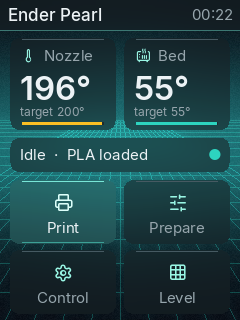
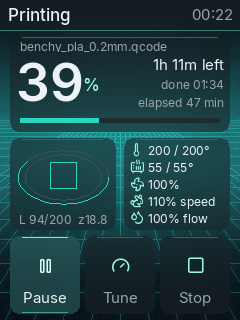

<p align="center"></p>

# Ender Pearl: a custom firmware and UI for the Creality Ender-3 V3 SE display

The Ender-3 V3 SE has a small 320 × 240 knob-driven screen (a **TJC3224T132_011N**). This project takes it over
completely: the display runs our own TJC firmware, and a Raspberry Pi 4 draws a modern "glass" interface on it,
in sync with a web UI that drives the printer.

> **Part of Ender Pearl.** This repository is a subset of the **Ender Pearl** project: a Raspberry Pi host for the
> Ender-3 V3 SE with its own G-code streamer, web slicer, printer controls and print queue. It holds only the
> display work: the reverse engineering, our firmware, the Pi display app and the tools to build them. Code from
> the rest of Ender Pearl appears only where the display depends on it (the display's web API in `server/`).

<p align="center">
  
  
  
</p>

**What it does**
- **Firmware:** our own firmware on the stock display, flashed **from the Pi over the display's existing serial
  wires**: no SD card, no soldering. Creality's firmware goes back on the same way.
- **UI:** a full printer UI on the knob:
  - home, printing (live layer preview, progress, time left);
  - files on the Pi and on the SD card, print queue;
  - move, temperatures, filament;
  - calibration prints, bed mesh;
  - tune and skip objects during a print;
  - wallpapers, sleep, clock.
- **Look:** anti-aliased Inter text, Lucide icons, translucent "glass" panels over six wallpapers, a boot animation.
- **One source of truth:** every action goes through the same web API as the browser UI, so the screen, the browser
  and the printer always agree, and every safety check lives in one place.

**Desktop controller:** a GNOME app on your PC mirrors the screen live and turns the knob, has a **no-code screen
designer** that draws on the printer as you edit, flashes firmware and runs a raw-command bench: [docs/08-controller.md](docs/08-controller.md).

All 33 screens (rendered by the real app code): [docs/images/screens.png](docs/images/screens.png) ·
wallpapers: [docs/images/wallpapers.png](docs/images/wallpapers.png)

> ⚠️ Flashing third-party firmware to a display can leave it unusable until you restore the original. Keep a copy
> of Creality's display firmware first ([docs/03-custom-firmware.md](docs/03-custom-firmware.md#back-to-stock)).
> Nothing here touches the printer's mainboard firmware.

## Why
The project started as a Raspberry Pi "closed loop" host for the printer: it streams G-code itself and adds a web
slicer and printer controls. The printer's own screen then showed Creality's menus, which knew nothing about
any of that. The goal became: **make the printer's own screen show the Pi's world**, and make it look and feel
like a modern printer UI, with cards, live previews and smooth text, on a small budget screen with a single knob.

Read the whole story, including the dead ends, in [docs/00-story.md](docs/00-story.md).

## How it works, in one picture

```
 Raspberry Pi 4                                                       Ender-3 V3 SE display
┌────────────────────────────────┐   UART3 (GPIO4/5) 921600 baud    ┌─────────────────────────────┐
│ glass_main.py  ── glass UI ────┼─────────────────────────────────▶│ TJC3224T132_011N            │
│   app.py (screens, cache)      │   TJC instructions:              │  our .tft: fonts + pictures │
│   canvas.py (flow control)     │   xpic / xstr / fill / line …    │  (no logic on the display)  │
│   gpio.py (knob A/B/ENTER) ◀───┼──────────── GPIO19/26/13 ────────┤  knob, backlight            │
│        │ HTTP                  │                                  └─────────────────────────────┘
│ web server (API, slicer, print │
│ streamer) ── USB ── printer    │
└────────────────────────────────┘
```

The display holds **only resources**: seven fonts and the pictures. It has one blank page and no logic. The Pi
draws every pixel with TJC's standard drawing instructions. Changing the layout is a Python edit on the Pi.
Only new fonts or pictures need a firmware rebuild.

## Repository layout

| Path | What |
|---|---|
| [docs/](docs/) | The write-up: story, hardware & pinout, protocols, firmware, drawing technique, Pi software, building assets, troubleshooting |
| [firmware/](firmware/) | `glass.tft` (the firmware running on the display) and `glass.hmi` (the TJC editor project it was built from) |
| [pi/display/](pi/display/) | Everything that runs on the Pi: the glass app, TJC driver, serial flasher, GPIO knob, stock-protocol tools |
| [server/](server/) | The display's web API (`display_api.py`, from the host project) and the systemd unit / installer |
| [design/](design/) | Laptop side: wallpapers → pictures, boot animation, logo, icon font, font metrics, mockup renderer, menu spec |
| [fonts/](fonts/) | The TJC font files (`.zi`) generated from Inter and our icon font |
| [tools/controller/](tools/controller/) | **Desktop app** (GNOME): live mirror + knob, no-code screen designer, flash, raw-command bench, service and logs ([docs](docs/08-controller.md)) |
| [tools/editor/](tools/editor/) | Running and scripting TJC's Windows editor under Wine on Linux |
| [tests/](tests/) | Unit tests for the protocol builders, TJC driver and UI (no hardware needed) |

## Quick start (if you have the same printer)
1. **Wire the display to the Pi** (printer off): [docs/01-hardware.md](docs/01-hardware.md#wiring-to-the-pi).
   Enable UART3: `dtoverlay=uart3` in `/boot/firmware/config.txt`, reboot.
2. **Check the link** without changing anything: `python3 pi/display/flash.py --probe`. The display should answer
   `comok … TJC3224T132_011N …`.
3. **Back up** Creality's display firmware (download link and checksum in
   [docs/03-custom-firmware.md](docs/03-custom-firmware.md#back-to-stock)).
4. **Flash**: `python3 pi/display/flash.py firmware/glass.tft`.
5. **Run the UI**: `pi/display/glass_main.py` (as a service: `server/install_display.sh`). It expects the host
   project's web API; see [docs/05-pi-software.md](docs/05-pi-software.md) for what it calls and how to adapt it.

Back to stock at any time: `python3 pi/display/flash.py --stock`, or Creality's `TJC_SET` folder on a microSD card in
the display's own slot.

## Credits and inspiration
- **jpcurti**, [E3V3SE_display_klipper](https://github.com/jpcurti/E3V3SE_display_klipper) and
  [ender3-v3-se-klipper-with-display](https://github.com/jpcurti/ender3-v3-se-klipper-with-display): the reverse
  engineering of the stock display protocol, the header labels and the wiring photo that got this started.
- **TJC / Nextion**: the documented standard instruction set and the serial upload protocol.
- **Inter** by Rasmus Andersson (SIL OFL 1.1) and **Lucide** icons (ISC): see [licenses/](licenses/).

## License
Our code, documentation, wallpapers and firmware build: **GPL-3.0** ([LICENSE](LICENSE)). Fonts and icons keep their
own licences ([licenses/](licenses/)). Not included and not ours: Creality's display firmware and TJC's USART HMI editor.
Get those from their makers.
