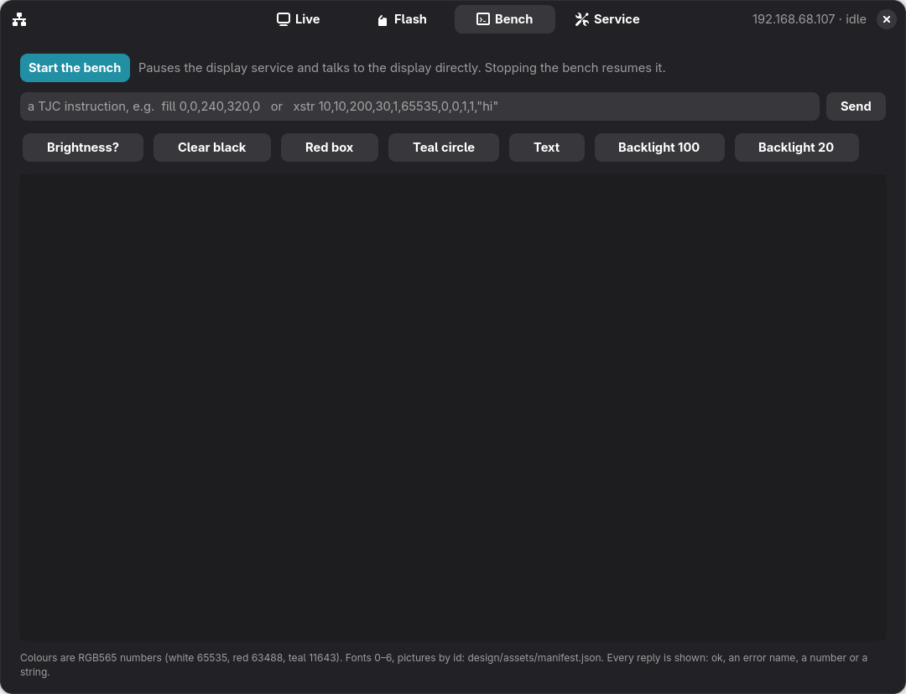

# Desktop controller

A GNOME app (GTK 4 / libadwaita) for your PC that reaches the printer's display through the Pi:
over Wi-Fi to the Ender Pearl web API, and over SSH for the rest.

| Live | Flash | Bench | Service |
|---|---|---|---|
|  |  |  |  |

## What it does
- **Live**
  - The printer's screen, mirrored live: it replays the display's own drawing commands with its own pictures and
    fonts.
  - The knob: buttons, the arrow keys / Enter / Esc, or the scroll wheel over the screen.
  - Wallpaper, brightness, sleep time, 12/24-hour clock, sending a message, jumping to a screen.
  - The printer's state and temperatures.
- **Flash**
  - Ask the display what it is: model, runtime version, flash size. This writes nothing.
  - Flash a `.tft` with a progress bar: the file goes to the Pi by `scp`, then `flash.py` sends it over UART3.
  - Put Creality's firmware back.
  - Flashing is only offered while the printer is idle.
- **Bench**
  - Pauses the display service, then sends raw TJC instructions and shows every reply: ok, the error name, a
    number or a string.
  - Has presets for quick tests. Stopping the bench, or closing the app, starts the service again.
- **Service**
  - Display service state with start / stop / restart buttons.
  - The web server's state, with a guarded restart that is refused while printing.
  - UART3 and its serial port, the last link message, and the display log, live.

## Install
Requirements on the PC:
- PyGObject with GTK 4 and libadwaita ≥ 1.5 (Fedora / Ubuntu 24.04+ GNOME have them);
- Pillow;
- `ssh` with key access to the Pi.

```bash
python3 tools/controller/ender_pearl_controller.py      # run it
tools/controller/install.sh                             # add "Ender Pearl Display" to the app list
```

The first time, open the connection menu (top left) and enter the Pi's host or IP, the SSH user and the project
folder. **Find the Pi** pings the local network and picks the Pi by its MAC address, which helps when its DHCP
address changes. Settings are saved in `~/.config/ender-pearl-controller/config.json`. The API token is read
from the Pi over SSH each time and never saved on the PC.

## How it talks to the Pi
| Feature | Path |
|---|---|
| mirror | `GET /api/display/frame`, pictures and fonts from `GET /api/display/asset` (cached in `~/.cache/ender-pearl-controller`) |
| knob | `POST /api/display/input` → a datagram to the display app on the Pi's `127.0.0.1:47321` |
| settings, message, go to a screen | `POST /api/display/config` |
| state | `GET /api/state` |
| flash, probe, restore | `scp` + `pi/display/flash.py` over SSH |
| bench | `systemctl --user stop ender-loop-display`, then `pi/display/bench.py` over SSH (stdin → display, replies as JSON lines) |
| service, log | `systemctl --user …`, `tail -F out/display.log` over SSH |

All SSH commands share one connection (OpenSSH `ControlMaster`), so a command takes ~35 ms after the first.
